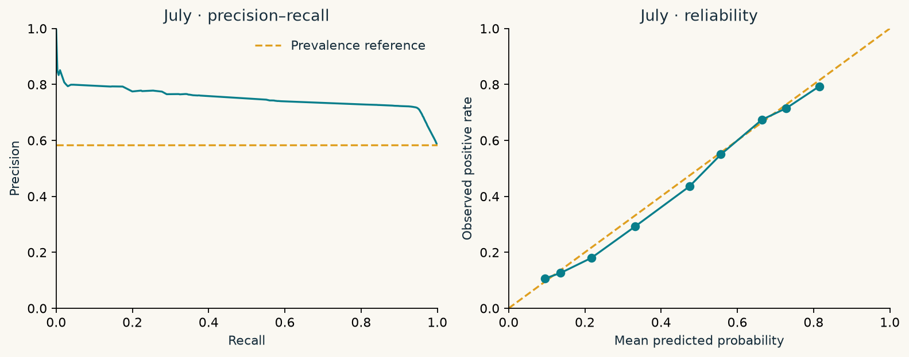

# 🚕 The Tipping Point

### Predicting generous tips in New York City yellow taxis

**Machine Learning Project · Team D · May–July 2026**

Can the context of a completed taxi trip help predict whether the passenger will leave a generous card tip? This project turns **600,000 NYC yellow-taxi records** from an instructor-provided sample into a reproducible binary-classification study, a set of four Jupyter notebooks, and an interactive results website.

**[Explore the interactive website](https://nyc-taxi-tip-lab-mateo.violetnashi2.chatgpt.site/)** · **[Try the frozen model](https://nyc-taxi-tip-lab-mateo.violetnashi2.chatgpt.site/#predictor)** · **[Read the detailed model card](MODEL_CARD.md)**

> **Main finding:** On the held-out July trips, the selected decision tree achieved **0.7474 average precision**, compared with **0.5845** for the constant-score majority baseline. This measures predictive ranking, **not classification accuracy** or passenger generosity itself.

## 1. Problem card

| Requirement | Project definition |
| --- | --- |
| **Question** | Can we predict whether an eligible NYC yellow-taxi passenger will leave a generous recorded card tip using information known before the tip is entered? |
| **Target** | Binary label `generous_tip = 1` when `tip_amount >= 0.25 * fare_amount`; otherwise `0`. Exactly 25% counts. The denominator is the positive **meter fare**, not the total charge. |
| **One row is** | One completed, eligible NYC yellow-taxi trip paid by card. |
| **Predict at** | The payment screen, after the trip has ended but **before** the tip is entered. |
| **Allowed information** | Pre-tip trip context: meter fare, travel time and distance, pickup/drop-off zones, trip timing, passenger count, rate code, and pre-tip charges. The **selected model uses fare, geography, and fees**. |
| **Left out** | `tip_amount`, `tip_pct`, `total_amount`, and the target itself. `payment_type` only determines eligibility and is not a predictor. No rider, driver, or vendor identity is used. Cash and other ineligible payment types are outside the study population. |
| **Positive rate** | **May: 56.17%** (training); **June: 59.54%** (validation); **July: 58.45%** (held-out test). Rates refer to *eligible, cleaned card trips*. |
| **Decision it supports** | An **educational, hypothetical driver-support insight** about recorded tip likelihood. It has **not** been validated for deployment, pricing, routing, worker evaluation, or passenger treatment. |
| **Costly mistake** | In the hypothetical decision exercise, a **false negative** (missed generous-tip insight) costs **2 units**, while a **false positive** (unhelpful prompt) costs **1 unit**. These are assumptions, not measured money. |
| **Metric** | **Average precision (AP)**, the non-interpolated precision–recall AUC, is primary. We also examine precision, recall, top-20% lift, Brier score, confusion counts, and cost per trip. |
| **Baseline to beat** | July majority/constant-score AP **0.5845**; fare-band rule **0.6564**; depth-2 tree **0.7063**. The selected depth-8 tree reaches **0.7474**. |

The prediction target is deliberately narrow: it is about **recorded card tips**, not hidden cash tips, satisfaction, service quality, income, or a passenger's character. See [the complete problem definition](PROBLEM.md).

## 2. Dataset and study design

The instructor's fixed **data-v2** sample is derived from [NYC Taxi & Limousine Commission trip records](https://www.nyc.gov/site/tlc/about/tlc-trip-record-data.page). The raw sample contains **600,000 records**. After defining payment eligibility and applying predeclared plausibility checks, the study uses the following split by **pickup month**:

| Period | Role | Eligible trips | How it is used |
| --- | --- | ---: | --- |
| **May 2026** | Train | **129,956** | Fit preprocessing, imputation, encoders, and candidate models; define the fare rule. |
| **June 2026** | Validate | **123,162** | Compare feature groups and models; choose the decision threshold. |
| **July 2026** | Final test | **119,811** | Score the frozen choice once and estimate test uncertainty. |

The split is **chronological, not random**. All learned transformations are fitted using May data only. June is used for selection, so June metrics can be optimistic. July is reserved for the final evaluation and must not be used for further tuning.

### Cleaning and eligibility rules

- Retain only `payment_type == 1` (card payments), because cash tips are not consistently observed. Exclude flex fares, no-charge, disputed, unknown-payment, and voided trips.
- Require a finite positive meter fare and a finite nonnegative recorded tip.
- Drop exact duplicates, invalid negative/infinite fees, implausible duration (**outside 0.5–240 minutes**), distance (**outside 0.01–100 miles**), and average speed (**over 100 mph**).
- Preserve valid records with unknown zones, nonstandard rate codes, or missing passenger counts using explicit indicators. Missing fees are imputed within the May-fitted pipeline.

These are documented study rules rather than cutoffs selected by looking at the held-out outcomes. The complete audit and cleaning tables appear in `reports/tables/` and the notebooks.

## 3. Model development

We compare a transparent sequence of baselines and single-model candidates:

1. **Majority-class baseline:** predict the most common class; use the May positive rate as a constant probability score.
2. **Fare-band rule:** use May fare bands and their recorded generous-tip rates.
3. **Depth-2 decision tree:** an interpretable, low-complexity benchmark.
4. **Candidate models:** logistic regression and individual decision trees with maximum depths 4, 6, or 8, plus a constrained depth-6 candidate.

Feature groups are added in a predeclared order and retained only if June AP increases by at least **0.001**. The retained groups were **fare, geography, and pre-tip fees**. Journey, calendar, passenger, rate, and quality groups did not meet this incremental-gain rule. This greedy process is order-dependent; it does not prove excluded features contain no information.

**Final selected model:** `DecisionTreeClassifier` with maximum depth **8**, trained on May only. The June-selected decision threshold is **0.32**, chosen to minimize hypothetical average decision cost on a fixed threshold grid. No ensembles or post-hoc probability calibration are used.

## 4. Final results — July 2026

| Model | Average precision ↑ | Precision | Recall | Lift in top 20% ↑ | Hypothetical cost / trip ↓ |
| --- | ---: | ---: | ---: | ---: | ---: |
| Majority baseline | 0.5845 | 58.45% | 100.00% | 1.000 | 0.4155 |
| Fare-band rule | 0.6564 | 75.73% | 41.63% | 1.295 | 0.7604 |
| Depth-2 decision tree | 0.7063 | 64.40% | 97.42% | 1.232 | 0.3450 |
| **Selected depth-8 tree** | **0.7474** | **71.37%** | **94.97%** | **1.328** | **0.2815** |

All results above use **119,811 July eligible trips**. The selected model's average-precision gain over the constant-score baseline is **+0.1629**. Its July Brier score is **0.1821**. At threshold **0.32**, it flags **77.78%** of eligible trips.

The selected model's July AP has a **95% trip-bootstrap interval of [0.7437, 0.7508]** from 500 paired resamples with fixed predictions. These intervals do not incorporate model-selection uncertainty or correlation between trips.



### What the numbers mean

- **Average precision** summarizes how well the model ranks genuinely generous recorded tips across decision thresholds; it is not accuracy.
- **Precision 71.37%:** among trips flagged positive, roughly 71 in 100 met the generous-tip target.
- **Recall 94.97%:** the model identified roughly 95 in 100 trips that actually met the target.
- **Cost 0.2815 per trip:** the selected model is lower-cost than the majority baseline **under the assumed 1:2 mistake costs**; no real-world monetary savings have been established.

The weakest reported subgroups include nonstandard-rate trips and several small early-morning or borough-specific slices. Aggregate performance should not be assumed to hold equally across every subgroup. See the [full evaluation](docs/evaluation.md), [July metric CSV](reports/test_metrics.csv), and [model limitations](MODEL_CARD.md).

## 5. Explore the interactive website

The [visual lab](https://nyc-taxi-tip-lab-mateo.violetnashi2.chatgpt.site/) includes:

- A walkthrough of the data-cleaning and study-design decisions.
- Tip-distribution, fare, time, and NYC taxi-zone explorations.
- Feature-selection and model-comparison explanations.
- A read-only **June** decision-threshold explorer.
- A browser demo of the **frozen** depth-8 tree, using exported inference parameters rather than a server-side API.

The interactive threshold explorer does not change the final model or reopen the July test set.

## 6. Repository structure

```text
my-ml-project/
├── README.md                 # Project overview and problem card
├── PROBLEM.md                # Target, eligibility, leakage, and split contract
├── MODEL_CARD.md             # Model use, evaluation, caveats, and provenance
├── VALIDATION.md             # Recorded technical verification
├── PEER_REVIEW.md            # Peer-review planning/status
├── data/
│   └── get_data.py          # Download instructor-provided assets
├── notebooks/
│   ├── 01-frame.ipynb       # Frame prediction question and target
│   ├── 02-clean-and-split.ipynb
│   ├── 03-features.ipynb
│   └── 04-evaluate.ipynb
├── src/taxi_tip/            # Reusable data, features, modeling, evaluation
├── reports/                 # Saved metrics, figures, and decision records
├── docs/                    # MkDocs pages and interactive visualizations
├── scripts/                 # Reproduction and website checks
├── tests/                   # Split, leakage, and freeze safeguards
├── requirements-lock.txt
└── pyproject.toml
```

Raw data, trained Python model binaries, and row-level prediction caches are **not** committed to Git. They are created locally when reproducing the full study.

## 7. Installation and usage

### Prerequisites

- **Python 3.11 or 3.12** (the recorded dependency environment used Python 3.11).
- Internet access for obtaining the instructor's dataset when reproducing training.
- Optional: **Node.js** to run the browser/Python prediction parity check.

```bash
git clone https://github.com/Mateos06/my-ml-project.git
cd my-ml-project
python -m venv .venv
```

Activate the environment:

```powershell
# Windows PowerShell
.\.venv\Scripts\Activate.ps1
```

```bash
# macOS / Linux
source .venv/bin/activate
```

Install and preview the committed website (no data download or retraining needed):

```bash
python -m pip install -r requirements-lock.txt
python -m pip install --no-deps -e .
python -m mkdocs serve
```

Open **http://127.0.0.1:8000** in your browser. To create a static site build:

```bash
python -m mkdocs build --strict
```

### Reproduce the research workflow

Run the commands below in order **from a fresh clone** after installing the dependencies:

```bash
python data/get_data.py
python -m pytest
python -m taxi_tip.cli develop
python -m taxi_tip.cli final --bootstrap 500
python scripts/execute_notebooks.py
python -m taxi_tip.cli docs
python scripts/export_lab.py
node scripts/check_browser_model.cjs
python -m mkdocs build --strict
python scripts/check_site.py
```

`develop` fits on May and makes choices using June. `final` checks frozen fingerprints, scores July once, and caches the result. Further invocations reuse saved results; **do not delete the July lock to adjust the model after seeing test performance**. Repeating this pipeline is replication of the same study, not an independent future test.

## 8. Validation and limitations

The repository's recorded validation includes **11 passing automated tests**, a successful strict MkDocs build, and a browser/Python parity check on **1,000 May trips**. These checks verify implementation properties; they do not establish production readiness.

Important limitations:

1. **Scope:** results apply to cleaned, eligible card-paid NYC yellow-taxi trips from May–July 2026, not cash tips or other populations.
2. **Missing human context:** trip records do not reveal intent, satisfaction, rider income, service quality, or the unobserved amount of cash tips.
3. **Time shift:** only one future month was held out; seasonal patterns, fare changes, and payment practices may affect generalization.
4. **Model selection:** June informed feature, model, and threshold choices, so June estimates are optimistic.
5. **Cost assumptions:** the 1-unit/2-unit decision costs are hypothetical and require stakeholder validation.
6. **Uncertainty:** bootstrap intervals keep the fitted model fixed and may be too narrow if trips are correlated.

There is **no deployment recommendation**, no claim of causality, and no completed fairness or full-year validation. Any future model change needs evaluation on a genuinely unseen period.

## 9. Documentation and sources

| Resource | Purpose |
| --- | --- |
| [Problem definition](PROBLEM.md) | Formal target, timing, exclusions, and evaluation contract |
| [Model card](MODEL_CARD.md) | Intended use, model performance, and failure modes |
| [Requirement traceability](docs/requirements.md) | How the coursework requirements map to evidence |
| [Evaluation narrative](docs/evaluation.md) | July results, uncertainty, and error slices |
| [Validation record](VALIDATION.md) | Tests, execution details, and website checks |
| [Presentation defense](presentation/DEFEND.md) | Prepared 15-minute project presentation |
| [Saved decision record](reports/selection.json) | Frozen model, feature groups, threshold, and hashes |
| [Saved final result](reports/final.json) | July reporting provenance and final outcomes |

**Data references:** [Instructor data-v2 release](https://github.com/evisp/ml-course-labs/releases/tag/data-v2) and [NYC TLC Trip Record Data](https://www.nyc.gov/site/tlc/about/tlc-trip-record-data.page).

## 10. Changes

- **2026-11-10 — README refresh:** placed the coursework problem card up front; clarified the target, prediction timing, eligibility, leakage restrictions, decision costs, positive rates, and baseline; connected these requirements to the saved July evaluation and reproducibility instructions. **Documentation only; no model retraining or new July scoring.**
- **2026-11-07 — Interactive presentation:** documented the responsive visual lab, frozen browser model, and verification checks in `VALIDATION.md`.
- **2026-11-03 — Recorded model evaluation:** completed the frozen May/June selection procedure and one final July scoring pass, with results reported in `reports/`.

---

### Academic responsibility

This is a learning and research project. OpenAI Codex assisted with code, tests, notebooks, analysis presentation, documentation, and website design. The team remains responsible for reviewing, understanding, reproducing, and defending its results. Peer review, classroom presentation, and instructor submission are **not claimed as completed**.

**The Tipping Point** — learning what trip records can predict, and where their limits begin.
