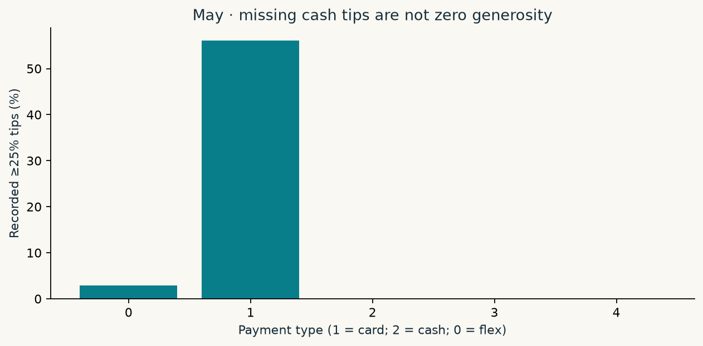
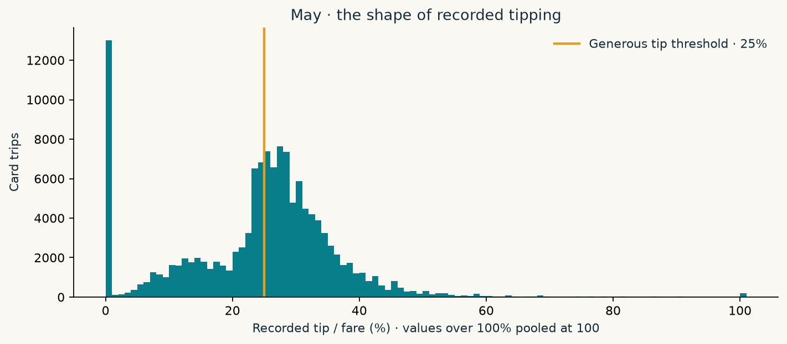
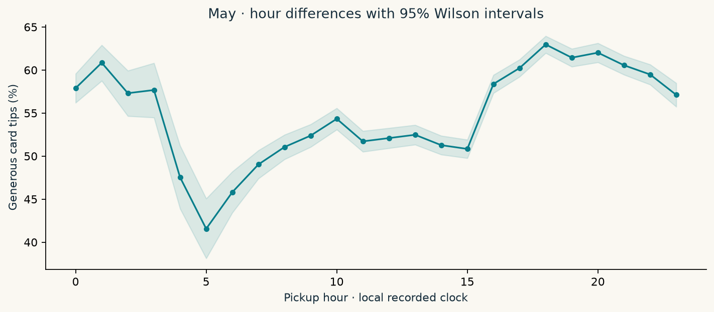
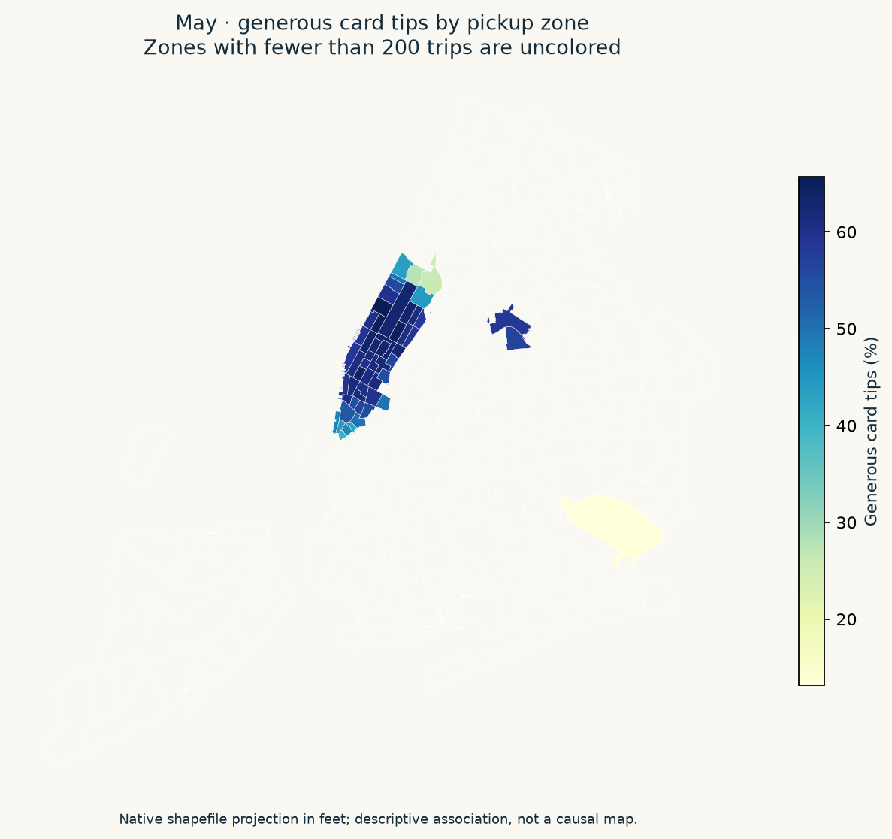

# From raw records to an observable target

The instructor release contains **600,000 rows** with 21 columns. We preserve the source and checksum it; cleaning rebuilds from raw files on every independent run.

## The timestamp audit

| pickup_month   |      n |
|:---------------|-------:|
| 2026-04        |      2 |
| 2026-05        | 199999 |
| 2026-06        | 200001 |
| 2026-07        | 199998 |

Counts follow recorded pickup timestamps, not an assumption of exactly 200,000 rows per calendar month. Rows outside May–July are excluded by the temporal read filters. This structural audit reads only pickup timestamps; July outcomes remain unopened until final evaluation.

## The cash leak, made visible

|   payment_type |   trips |   valid_fare_trips |   recorded_nonzero_tip_rate |   recorded_25pct_rate | interpretation                    |
|---------------:|--------:|-------------------:|----------------------------:|----------------------:|:----------------------------------|
|              0 |   46601 |              46539 |                      0.0934 |                0.0284 | not an observable card-tip target |
|              1 |  133571 |             133558 |                      0.9019 |                0.5610 | observable target                 |
|              2 |   18149 |              17934 |                      0.0000 |                0.0000 | not an observable card-tip target |
|              3 |     570 |                473 |                      0.0000 |                0.0000 | not an observable card-tip target |
|              4 |    1108 |                663 |                      0.0000 |                0.0000 | not an observable card-tip target |

These are **recorded** rates, not true tip rates for non-card payments. A cash zero is a missing cash-tip measurement. Including cash as a negative class creates an observability shortcut through payment type and its proxies. It does not show that cash passengers are less generous. The production feature allowlist excludes payment type after using it to select card trips.

## Every cleaning decision has a count

The table is May only. Its positive-rate denominator is the remaining card trips with a valid fare and tip, even before the card-only filter. It never assigns negative labels to cash trips.

| step                    | decision                                                             |   remaining |   removed |   card_positive_rate |
|:------------------------|:---------------------------------------------------------------------|------------:|----------:|---------------------:|
| Raw rows                | audit; positive rate denominator is eligible card trips only         |      199999 |         0 |               0.5610 |
| Exact duplicates        | drop duplicate rows                                                  |      199999 |         0 |               0.5610 |
| Observable card tips    | drop cash, flex, no-charge, disputes, unknown and voided             |      133571 |     66428 |               0.5610 |
| Positive fare           | drop zero, negative, missing or infinite fares                       |      133558 |        13 |               0.5610 |
| Valid tip               | drop negative, missing or infinite tips                              |      133558 |         0 |               0.5610 |
| Nonnegative charges     | drop negative or infinite fees; missing fees imputed in May pipeline |      133558 |         0 |               0.5610 |
| Plausible duration      | drop missing, <30 seconds or >4 hours                                |      130303 |      3255 |               0.5616 |
| Plausible distance      | drop missing, <0.01 or >100 miles                                    |      129961 |       342 |               0.5616 |
| Plausible average speed | drop >100 mph                                                        |      129956 |         5 |               0.5617 |
| Retain flagged cases    | flag unknown zones, nonstandard rates and unknown passengers         |      129956 |         0 |               0.5617 |

[May audit](downloads/cleaning_train.csv) · [June audit](downloads/cleaning_validation.csv) · [July audit](downloads/cleaning_test.csv)

[Raw-column missingness and negative-value audit](downloads/raw_column_audit.csv) · [Retained flags with counts](downloads/retained_flags.csv)

Unknown zones are retained as category 265 and flagged; missing, zero or invalid passenger counts become an explicit unknown category. Nonstandard fares remain with their rate codes and a flag. Flex fares are excluded because the target is defined for card trips, not because missing metadata alone makes a trip invalid. Negative fare, tip or component fees are dropped; we do not flip their signs. Total amount is audited but never used for eligibility, features or target construction because it already includes the outcome. Fixed journey limits may remove some unusual legitimate trips, so conclusions apply to the eligible population.

## What the tip distribution tells us

Peaks and round percentages are consistent with people using customary amounts or payment-screen presets. The record does not contain the screen choices, so it cannot prove that mechanism. Fare-only percentages may also differ from presets calculated on a larger pre-tip charge. Values above 100% are retained in modeling and pooled only in the final histogram bin.

## Differences that might matter

These are May associations, with Wilson 95% intervals and sample sizes. A difference of at least five percentage points from the May population rate is labelled practically large, before considering uncertainty. This is descriptive screening, without multiple-comparison correction or a causal interpretation.

|   airport_trip |      n |   positives |   rate |   lower_95 |   upper_95 |   difference_pp | practically_large   |
|---------------:|-------:|------------:|-------:|-----------:|-----------:|----------------:|:--------------------|
|              0 | 117996 |       68597 | 0.5814 |     0.5785 |     0.5842 |          1.9683 | False               |
|              1 |  11960 |        4395 | 0.3675 |     0.3589 |     0.3762 |        -19.4192 | True                |

| fare_band   |     n |   positives |   rate |   lower_95 |   upper_95 |   difference_pp | practically_large   |
|:------------|------:|------------:|-------:|-----------:|-----------:|----------------:|:--------------------|
| 0–10        | 38833 |       29568 | 0.7614 |     0.7571 |     0.7656 |         19.9747 | True                |
| 10–20       | 50396 |       33072 | 0.6562 |     0.6521 |     0.6604 |          9.4576 | True                |
| 20–40       | 26550 |        6664 | 0.2510 |     0.2458 |     0.2562 |        -31.0669 | True                |
| 40–80       | 13083 |        3509 | 0.2682 |     0.2607 |     0.2759 |        -29.3456 | True                |
| 80+         |  1094 |         179 | 0.1636 |     0.1429 |     0.1867 |        -39.8047 | True                |

Full tables: [distance](downloads/rates_distance_band.csv), [duration](downloads/rates_duration_band.csv), [hour](downloads/rates_pickup_hour.csv), [day of week](downloads/rates_day_of_week.csv), [passengers](downloads/rates_passenger_count.csv), [borough](downloads/rates_pickup_borough.csv), [nonstandard rates](downloads/rates_nonstandard_rate.csv). Day 0 is Monday; airport 1 means pickup or drop-off is EWR, JFK or LGA.

## Geography, without false precision

The map uses the supplied shapefile's native projected coordinates in feet, with no latitude/longitude claim. Zones with fewer than 200 eligible May trips are uncolored. Zone-only data cannot locate a rider or resolve within-zone differences.
