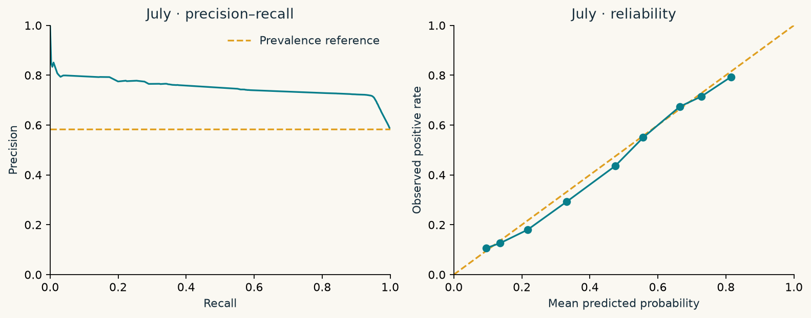
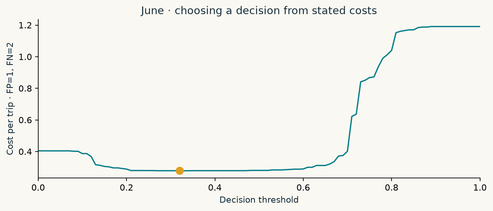
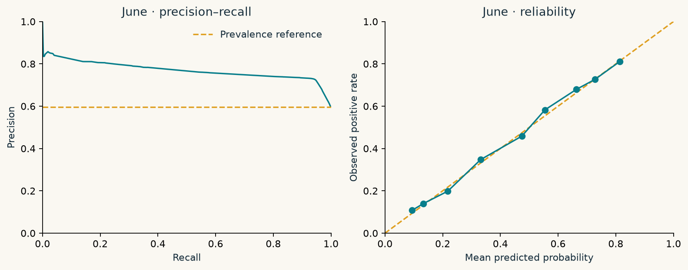

# One final look at July

Features, model and threshold were selected on June before opening July outcomes. The July evaluator verifies frozen SHA-256 hashes, creates an exclusive lock, saves one prediction pass, and calculates reports from that cache. There is no automatic retry that silently scores the holdout again.

## What survived the month change

| model        |      n |   average_precision |   precision |   recall |   lift_at_20pct |   cost_per_trip |   threshold |
|:-------------|-------:|--------------------:|------------:|---------:|----------------:|----------------:|------------:|
| majority     | 119811 |              0.5845 |      0.5845 |   1.0000 |          1.0000 |          0.4155 |      0.5000 |
| fare_rule    | 119811 |              0.6564 |      0.7573 |   0.4163 |          1.2955 |          0.7604 |      0.7614 |
| tree_depth_2 | 119811 |              0.7063 |      0.6440 |   0.9742 |          1.2323 |          0.3450 |      0.3900 |
| selected     | 119811 |              0.7474 |      0.7137 |   0.9497 |          1.3279 |          0.2815 |      0.3200 |

The selected model's AP changes from **0.7637 in June** to **0.7474 in July**. Constant-score AP equals the July positive prevalence. Average precision is non-interpolated PR AUC; it is not trapezoidal area and not accuracy.

## Uncertainty beside the baseline

| metric            | estimator   |   estimate |   lower_95 |   upper_95 |   repetitions | unit   |
|:------------------|:------------|-----------:|-----------:|-----------:|--------------:|:-------|
| average_precision | model       |     0.7474 |     0.7437 |     0.7508 |           500 | trip   |
| average_precision | majority    |     0.5845 |     0.5818 |     0.5873 |           500 | trip   |
| average_precision | difference  |     0.1629 |     0.1601 |     0.1657 |           500 | trip   |
| precision         | model       |     0.7137 |     0.7110 |     0.7164 |           500 | trip   |
| precision         | majority    |     0.5845 |     0.5818 |     0.5873 |           500 | trip   |
| precision         | difference  |     0.1291 |     0.1275 |     0.1308 |           500 | trip   |
| recall            | model       |     0.9497 |     0.9479 |     0.9512 |           500 | trip   |
| recall            | majority    |     1.0000 |     1.0000 |     1.0000 |           500 | trip   |
| recall            | difference  |    -0.0503 |    -0.0521 |    -0.0488 |           500 | trip   |
| lift_at_20pct     | model       |     1.3279 |     1.3193 |     1.3365 |           500 | trip   |
| lift_at_20pct     | majority    |     1.0000 |     1.0000 |     1.0000 |           500 | trip   |
| lift_at_20pct     | difference  |     0.3279 |     0.3193 |     0.3365 |           500 | trip   |
| cost_per_trip     | model       |     0.2815 |     0.2790 |     0.2843 |           500 | trip   |
| cost_per_trip     | majority    |     0.4155 |     0.4127 |     0.4182 |           500 | trip   |
| cost_per_trip     | difference  |    -0.1339 |    -0.1368 |    -0.1310 |           500 | trip   |

**500 paired bootstrap resamples**, trip-level, seed 2026, percentile 95% intervals. Each resample uses the same indices for model and majority; the difference rows are paired model-minus-baseline contrasts. A negative cost difference is better. Predictions stay fixed throughout. Correlated trips and model-selection uncertainty are not represented; these are conditional intervals for this evaluation sample, not guarantees about future months.

## A decision threshold with a stated price

We assign a false positive 1 cost unit and a false negative 2. The June-selected threshold is **0.32**, with July cost **0.2815** per trip versus majority cost **0.4155**. The reduction is **0.1339** cost units per trip under those assumed costs. No dollars or operational benefit have been measured.

<label for="threshold">Explore the June decision curve · threshold <b data-value>0.32</b></label>
<input id="threshold" type="range" min="0" max="100" value="32" aria-label="June decision threshold">

<strong data-cost>—</strong>Cost per trip<strong data-fp>—</strong>False positives<strong data-fn>—</strong>False negatives

Read-only exploration of June. This control never changes the frozen threshold or scores July.

## Reliability, not just ranking

July Brier score is **0.1821**, versus **0.2434** for constant May prevalence. Reliability tables contain counts, mean predicted probability and observed positive rate in fixed 0.1 bins; empty bins are omitted. No post-hoc calibration is fitted, and small bins should not be overinterpreted.

[June reliability](downloads/validation_reliability.csv) · [July reliability](downloads/test_reliability.csv)

## Where the model is least useful

The eight highest-cost slices with at least 200 eligible July trips are below. Slices overlap, so counts must not be added together. Selection of these slices is descriptive after testing, not a basis for retuning the model.

| slice            | value    |    n |   positive_rate |   average_precision |   precision |   recall |   cost_per_trip |
|:-----------------|:---------|-----:|----------------:|--------------------:|------------:|---------:|----------------:|
| pickup_hour      | 4        |  553 |          0.4774 |              0.6829 |      0.6070 |   0.9242 |          0.3580 |
| nonstandard_rate | 1        | 8424 |          0.0937 |              0.0876 |      0.0674 |   0.1534 |          0.3573 |
| pickup_hour      | 3        |  802 |          0.5137 |              0.6595 |      0.6173 |   0.9515 |          0.3529 |
| pickup_hour      | 6        | 1549 |          0.4971 |              0.6575 |      0.6139 |   0.9416 |          0.3525 |
| passenger_count  | nan      |  403 |          0.5831 |              0.7330 |      0.6667 |   0.9362 |          0.3474 |
| pickup_hour      | 5        |  637 |          0.4788 |              0.6313 |      0.6187 |   0.9311 |          0.3407 |
| pickup_borough   | Brooklyn |  699 |          0.2289 |              0.4925 |      0.4485 |   0.7625 |          0.3233 |
| pickup_hour      | 2        | 1216 |          0.5576 |              0.6828 |      0.6616 |   0.9572 |          0.3207 |

The [full July slice table](downloads/test_slices.csv) includes every slice, counts and a small-sample flag. [June slices](downloads/validation_slices.csv) were available during development. Unknown passenger values are labelled `nan` in exported tables.

[Download July metrics](downloads/test_metrics.csv) · [Paired intervals](downloads/bootstrap_intervals.csv) · [Frozen provenance](downloads/final.json)
