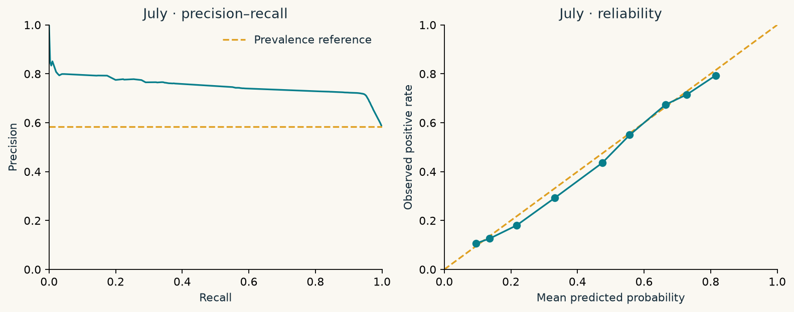

---
hide:
  - toc
---
<section class="hero">
<svg class="hero-line" viewBox="0 0 240 240" aria-hidden="true"><path d="M10 220V120H70V40H140V180H210V10M0 70H230M0 145H230M40 0V240M180 0V240"/></svg>

Project 01 / Team D / New York City

<h1>The tipping point.</h1>

A trip ends. The payment screen opens. How much can the journey tell us about a generous tip?

From 600,000 raw taxi records to one held-out result. A transparent study of what simple models can—and cannot—learn about recorded card tips.

<a class="button" href="evaluation/">Explore the results →</a>
<a class="button secondary" href="reproduce/">Reproduce the study</a>

<strong>25% of fare</strong>Our positive target<strong>May → June → July</strong>Fit · choose · test<strong>tree depth 8</strong>Chosen on June

</section>

0.747

July average precision

95% CI 0.744–0.751

0.585

Constant-score baseline AP

July positive prevalence

1.33×

Lift in the top 20%

Compared with the July population

119,811

Eligible July card trips

One frozen scoring pass

<strong>The measured result</strong> The selected model changes average precision by +0.163 versus the constant-score baseline. At the June-selected threshold, July precision is 71.4% and recall is 95.0%. These are limits of this study, not a claim that a trip record can reveal a person's generosity.

## First, ask a question the data can answer

Cash tips are absent from the meter record. Treating those zeros as failed generosity would teach a model about payment recording. We ask a narrower question: **among eligible card trips, is the recorded tip at least 25% of the fare?**

<article>
01 / Define the population
<h3>Missing is not ungenerous.</h3>
The payment audit makes the cash problem visible. Every removal has a count and a remaining positive rate.
<a href="data/">Inspect the cleaning evidence →</a></article><article>
02 / Respect the clock
<h3>The tip stays outside the model.</h3>
Distance and duration are known at payment. The tip and total charge are not usable predictors.
<a href="features/">Inspect the feature decisions →</a></article>

## Three months, three different jobs

<b>May · fit</b>129,956 eligible trips All learned preprocessing and models

<b>June · choose</b>123,162 eligible trips Features, model, threshold

<b>July · test once</b>119,811 eligible trips Frozen predictions and intervals

Read the [model card](model-card.md) for failure slices and limits, or use the [15-minute defense](presentation.md) to walk through the evidence. The [peer review](peer-review.md) remains pending until Team A's repository is available.

Measured from the instructor's fixed data-v2 sample. Aggregate reports and figures are generated by Python. No demonstration metrics are presented as real results.

