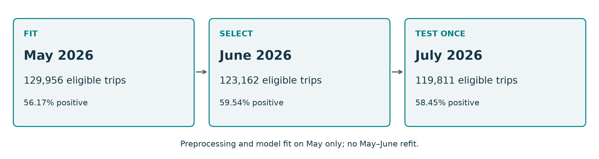
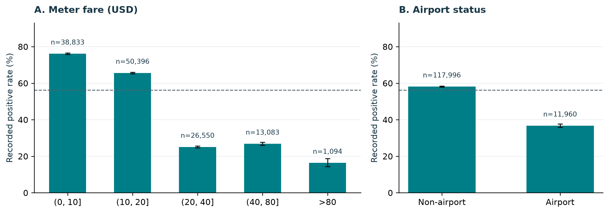
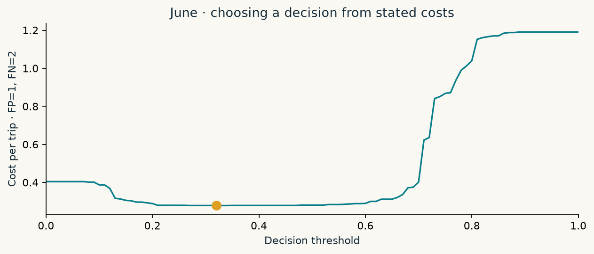
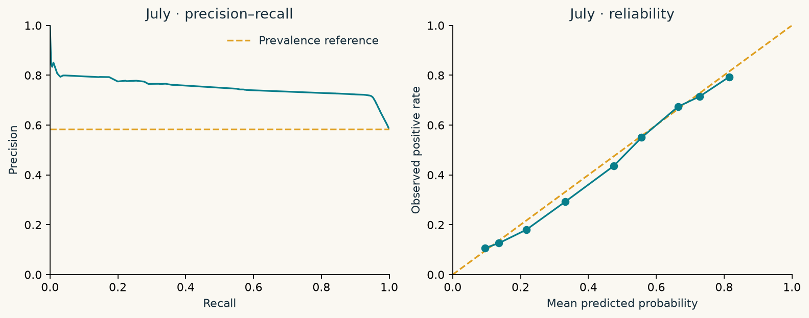

# The Tipping Point

**Predicting Recorded Generous Card Tips in New York City Yellow Taxis: A Reproducible Temporal Classification Study**

**Team D · Machine Learning Project**  
Research paper · 17 November 2026  
Study period: May–July 2026 · Recorded evaluation: 3 November 2026

## Abstract

This study examines whether information available at the end of a taxi trip can predict a recorded card tip of at least 25% of the meter fare. An instructor-provided sample contains 600,000 New York City yellow-taxi records. After restricting the population to eligible card payments and applying fixed data-quality rules, 372,929 trips remain across May, June, and July 2026. May supplies 129,956 training observations, June supplies 123,162 validation observations, and July supplies 119,811 held-out test observations. All learned preprocessing and model fitting use May only. Feature groups, model complexity, and decision thresholds are selected using June; July predictions are generated once after the analysis is frozen. Comparisons include a constant-score majority baseline, a fare-band rule, logistic regression, and individual decision trees. The selected depth-eight tree uses fare, geography, and pre-tip fees. On July, its average precision is 0.7474, compared with 0.5845 for the constant-score baseline; the paired bootstrap interval for the improvement is 0.1601–0.1657. At the June-selected threshold of 0.32, precision is 71.37%, recall is 94.97%, and hypothetical cost is 0.2815 units per trip, versus 0.4155 for the majority decision. Performance is uneven across trip types, particularly nonstandard fares. The findings establish predictive signal within the observed card-payment population, while leaving causal explanations, unrecorded cash tips, future-season generalization, and operational benefits unresolved.

**Keywords:** taxi trip records; binary classification; recorded tipping; temporal validation; average precision; decision trees; reproducibility.

## 1. Introduction

Taxi trip records connect an observed payment outcome with measurable features of a completed journey. They therefore offer a practical setting for studying a central machine-learning question: how much can a model predict from information that is actually available when a decision must be made? For this project, the decision moment is the payment screen after a trip ends and before the passenger enters a tip. Fare, completed-trip distance and duration, location identifiers, and pre-tip fees are available at that point.

The project asks whether these features help predict a recorded tip meeting a specified threshold. It deliberately defines “generous” as a label in the dataset: a tip of at least 25% of a positive meter fare. The term does not measure a passenger's character, intent, satisfaction, or total generosity. Cash tips are not observed in the same way as card tips, and the dataset does not contain the social and service context needed to explain why a person tips.

The practical motivation is an educational, hypothetical driver-support insight. A positive prediction could indicate that a completed trip resembles previously observed trips meeting the recorded-tip threshold. The study does not establish that such information would improve service or income. Because the journey has already ended at prediction time, these results also do not validate a system for deciding which trips to accept or where to drive beforehand.

Three research questions organize the analysis. **RQ1:** Can permitted pre-tip features outperform simple baselines on a later month? **RQ2:** Which candidate feature groups improve validation performance under a fixed selection procedure? **RQ3:** What do decision costs, uncertainty, calibration diagnostics, and subgroup errors reveal beyond a single aggregate score?

The contribution is a transparent empirical workflow rather than a new learning algorithm. It connects an observable target, an auditable population definition, chronological separation of training and evaluation, explicit feature selection, and a frozen final comparison. The accompanying notebooks, source package, original dataset, reports, and interactive website make these decisions inspectable. All empirical results in this paper come from the repository's saved analysis; writing the paper did not initiate another model fit or July scoring pass. [[9]](https://github.com/Mateos06/my-ml-project/tree/6f7cc9f503d8746cdffb43aebedbdd495ba94316)

## 2. Background and methodological context

The NYC Taxi and Limousine Commission publishes trip records containing timestamps, locations, distances, fares, payment types, and passenger counts. The records originate from reporting technology providers, and TLC does not guarantee their accuracy. They require substantive validation before modeling. [[1]](https://www.nyc.gov/site/tlc/about/tlc-trip-record-data.page)

The yellow-taxi data dictionary is particularly important for interpreting the outcome: recorded tips reflect card transactions, while cash tips are absent from that field. A zero cash-tip entry therefore cannot be treated as evidence that no tip was paid. This measurement distinction motivates the card-only study population. [[2]](https://www.nyc.gov/assets/tlc/downloads/pdf/data_dictionary_trip_records_yellow.pdf)

The methodological basis combines straightforward supervised learning with controls against information leakage. Fitting preprocessing on training data and applying the same transformations to later observations prevents validation and test information from entering learned statistics. Pipelines support this separation. [[3]](https://scikit-learn.org/1.8/common_pitfalls.html) Individual decision trees provide nonlinear partitions and readable rules; depth and minimum leaf size constrain their complexity. [[4]](https://scikit-learn.org/1.8/modules/tree.html)

Ranking quality, probability quality, and a thresholded decision answer different questions. Average precision summarizes a precision–recall curve using recall increments rather than trapezoidal interpolation. [[5]](https://scikit-learn.org/1.8/modules/generated/sklearn.metrics.average_precision_score.html) Reliability diagrams compare predicted probabilities with observed event frequencies, while the Brier score measures overall probabilistic error and is not a pure measure of calibration. [[6]](https://scikit-learn.org/1.8/modules/calibration.html) Bootstrap resampling provides a framework for estimating sampling variability, subject to the assumptions of the resampling unit and procedure. [[7]](https://doi.org/10.1214/aos/1176344552)

This is a focused empirical application of those methods. It does not claim an exhaustive review of tipping research or compare against published taxi models evaluated on incompatible samples. Its comparisons use the same project population and temporal protocol.

## 3. Dataset, target, and study population

### 3.1. Source and temporal coverage

The exact input is the instructor's fixed `data-v2` release, rather than a newly collected extract of the full TLC archive. [[8]](https://github.com/evisp/ml-course-labs/releases/tag/data-v2) It contains a 600,000-row, 21-column Parquet sample and supporting zone and field-definition assets. The repository now includes the four unmodified source files in `data/dataset/`, together with SHA-256 checksums. The sampling mechanism and any instructor preparation are not independently reconstructed here; population-wide representativeness cannot be assumed from the sample size alone.

An audit of recorded pickup timestamps identifies two April rows, 199,999 May rows, 200,001 June rows, and 199,998 July rows. The two April records fall outside the specified analysis windows. Assignment uses pickup time even when a trip ends in the next month. This distinction avoids assuming exactly 200,000 records in each calendar split.

**Table 1. Temporal cohorts and observed class balance.**

| Pickup month | Role | Raw rows | Eligible rows | Positive labels | Positive rate |
| --- | --- | ---: | ---: | ---: | ---: |
| May 2026 | Training | 199,999 | 129,956 | 72,992 | 56.17% |
| June 2026 | Validation and selection | 200,001 | 123,162 | 73,329 | 59.54% |
| July 2026 | Final test | 199,998 | 119,811 | 70,035 | 58.45% |
| Total in the three splits | Study population | 599,998 | 372,929 | 216,356 | — |

Source: `reports/tables/pickup_month_audit.csv`, the three cleaning audits, `reports/selection.json`, and the June/July metric tables. Positive rates use eligible rows, not all raw records.



*Figure 1. Chronological separation of responsibilities. The diagram summarizes saved cohort counts; it does not represent a new analysis run.*

### 3.2. Target and information available at prediction

For an eligible card-paid trip, the binary outcome is defined by:

**y = 1{tip_amount ≥ 0.25 × fare_amount}.**

Exactly 25% is positive. The denominator is the meter fare, not the total charge or a pre-tip sum of fare and surcharges. For example, a $5 recorded card tip on a $20 fare is positive, while a $4 tip on that fare is negative. The study requires a finite, strictly positive fare and a finite, nonnegative tip to construct this outcome.

Permitted predictors describe the completed trip before tip entry. The feature allowlist excludes `tip_amount`, `tip_pct`, `generous_tip`, and `total_amount`; total charge is especially problematic because it already contains the outcome. `payment_type` identifies the eligible population but is also excluded from predictors. Driver, rider, and vendor identifiers are not used. Vendor, store-and-forward, and request-source variables are excluded by design rather than rejected by an empirical feature comparison.

Eligibility uses the recorded tip to establish whether a valid retrospective label exists. An operational system would need a separate policy for missing or invalid future outcomes; the retrospective filter is not a claim that the tip is known before prediction.

### 3.3. Payment observability

The May payment audit demonstrates why payment type cannot be ignored. Of 199,999 raw May trips, 133,571 are coded as card payments, 18,149 as cash, and 46,601 as flex fares. The remaining 1,678 have no-charge or disputed codes. Among the 17,934 cash trips meeting the audit's fare/tip validity condition, the recorded nonzero-tip rate is zero. That is a property of the recording process, not a measured absence of cash tipping.

For the corresponding 133,558 valid card trips before journey-quality filtering, 90.19% have a nonzero recorded tip and 56.10% meet the 25% threshold. Restricting to `payment_type == 1` therefore aligns the target with its observation mechanism. Flex fares and other payment codes remain outside scope even when a tip entry exists. The final May prevalence changes slightly to 56.17% after all cleaning steps.

### 3.4. Cleaning and retained uncertainty

Cleaning is deterministic and applied separately after the temporal read. It first removes exact duplicates, keeps card payments, validates the fare and tip, and rejects negative or infinite component charges. It then retains durations from 0.5 to 240 minutes, distances from 0.01 to 100 miles, and average speeds no greater than 100 mph. These cutoffs are fixed project policies, not quantiles fitted on combined data. Their plausibility does not imply that every excluded trip is erroneous.

**Table 2. Remaining observations after each ordered cleaning decision.**

| Step | May | June | July |
| --- | ---: | ---: | ---: |
| Raw rows within the month | 199,999 | 200,001 | 199,998 |
| Remove exact duplicates | 199,999 | 200,001 | 199,998 |
| Keep observable card payments | 133,571 | 126,923 | 123,446 |
| Require positive finite fare | 133,558 | 126,898 | 123,387 |
| Require valid nonnegative tip | 133,558 | 126,898 | 123,387 |
| Require nonnegative finite charges | 133,558 | 126,898 | 123,387 |
| Apply duration bounds | 130,303 | 123,541 | 120,213 |
| Apply distance bounds | 129,961 | 123,162 | 119,826 |
| Apply average-speed bound | 129,956 | 123,162 | 119,811 |

Source: `reports/tables/cleaning_train.csv`, `cleaning_validation.csv`, and `cleaning_test.csv`. Missing component fees are retained for training-fitted imputation; “finite charges” means infinite values are rejected, not that missing fees are discarded. The unchanged rows show that a rule may be implemented without removing additional observations in this sample.

Uncertain metadata is handled explicitly instead of deleting every affected row. Zone identifiers outside the integer range 1–263 are mapped to category 265 and flagged. Missing or invalid passenger counts become an unknown category. Nonstandard rate codes remain in the data with an indicator. The May cohort contains 759 trips with an unknown zone, 12,034 with a nonstandard rate, and 516 with unknown passenger count; these flags can overlap. Valid large tips remain in the target, while the descriptive histogram alone pools tip percentages above 100% into its final bin.

The raw May audit also records 46,601 missing passenger counts and rate codes, alongside a completely missing `request_source` field. These counts describe the raw population and should not be confused with the much smaller unknown-passenger count after eligibility and cleaning. Negative fees and fares are dropped according to the ordered rules rather than converted to positive amounts. `total_amount` is audited but does not determine eligibility or model inputs.

## 4. Methods

### 4.1. Temporal development and final evaluation

Every imputer, scaler, encoder, and estimator is fitted using May observations only. June supplies feature-group comparisons, model selection, cost-based thresholds, and development diagnostics. The selected model is not refitted on combined May and June data. July evaluates that unchanged fitted model and the frozen thresholds.

The implementation stores hashes of the source, data, zone lookup, and serialized models. Before final scoring, it verifies those fingerprints and creates an exclusive `artifacts/july.lock`. Predictions are saved before subsequent reporting and bootstrap calculations. A completed final run returns its saved result; development refuses to proceed after the lock exists. These controls reduce accidental reuse, although manual deletion could bypass them. Research discipline is therefore still necessary.

### 4.2. Feature construction and preprocessing

Eight groups represent hypotheses about potentially useful trip context. Duration comes from the difference between recorded drop-off and pickup times; average speed combines duration and distance. Calendar fields include pickup hour, cyclic sine/cosine encodings, and day of week. Airport status indicates whether pickup or drop-off uses the EWR, JFK, or LGA zone identifiers. Zone identifiers are categorical, preventing their numbers from being treated as an ordered geographical scale.

**Table 3. Candidate feature groups and their representations.**

| Group | Candidate information | Representation |
| --- | --- | --- |
| Fare | Meter fare | Numeric |
| Journey | Duration, trip distance, average speed | Numeric |
| Calendar | Pickup hour, sine/cosine of hour, day of week | Numeric and categorical |
| Geography | Pickup/drop-off zones, pickup borough, airport indicator | Categorical zones/borough; numeric indicator |
| Passengers | Passenger count, including unknown | Categorical |
| Rate | End-of-trip rate code | Categorical |
| Fees | Extra, MTA tax, tolls, improvement surcharge, congestion surcharge, airport fee, CBD congestion fee | Numeric |
| Quality | Unknown-zone, nonstandard-rate, unknown-passenger flags | Numeric indicators |

Numeric preprocessing uses median imputation with empty features retained, followed by standard scaling. Categorical values are converted to strings, missing entries become `Unknown`, and one-hot encoding ignores unseen categories at prediction time. A column transformer drops all columns outside the chosen groups. These transformations are learned in the same May-fitted pipeline as each estimator.

### 4.3. Feature selection

Selection starts with fare and tests the remaining groups in the fixed order shown in Table 3. Each proposed addition is evaluated with logistic regression. It is retained only when June average precision increases by at least 0.001 relative to the current retained set. Later proposals build on accepted groups, and rejected proposals are recorded as well as successful ones.

This is a greedy, order-dependent procedure. It is not an exhaustive search, a statistical test of a feature's intrinsic value, or a leave-one-group-out analysis. Because logistic regression drives selection, the resulting representation may not be optimal for decision trees. The selected representation is subsequently shared by all learned model candidates.

### 4.4. Baselines and model candidates

The first baseline returns the May positive prevalence, 0.561667, for every observation. At a 0.5 threshold it predicts the positive majority class for all June and July trips. Its average precision equals the evaluated month's positive prevalence, although its constant probability is learned from May. Its top-20% lift is one.

The second baseline is a deliberately simple fare-band rule. May selects the fare band with the highest positive rate among bands containing at least 200 observations. The selected band is (0, 10] dollars, with positive rate 0.761414. Trips in that band receive that score; all other bands receive the lowest May band rate, 0.163620. Thresholding at the high score therefore flags only the selected band. The lower score is not an estimated pooled probability for the complement, which helps explain this rule's weak Brier score. The rule is primarily an interpretable decision baseline.

Learned candidates comprise logistic regression and single decision trees with maximum depths 2, 4, 6, and 8 and a minimum leaf size of 200. An additional depth-six tree uses a minimum leaf size of 1,000. Logistic regression uses `C=1.0`, `solver=lbfgs`, and `max_iter=1500`. The recorded implementation uses scikit-learn 1.8.0, with its default L2 logistic regularization and default Gini tree criterion. The seed is 2026. No boosting, random forest, or other ensemble is fitted.

June average precision selects the final learned model, with cost and then model name providing deterministic tie-breaking. Each learned candidate has its own June-selected cost threshold. The depth-two tree also serves as the strongest member of the simple baseline ladder. Its exported numeric split values are in May-standardized units and must not be read as dollar values. Its printed class labels reflect the tree's default class choice, whereas evaluation uses a separate threshold on predicted probabilities.

### 4.5. Metrics and the decision threshold

Average precision (AP) is the primary ranking measure. It weights the precision at each score cutoff by the associated increment in recall. The project uses scikit-learn's non-interpolated definition rather than trapezoidal precision–recall area. AP is not classification accuracy. Positive labels account for roughly 56–60% of eligible trips, so this is not a rare-event classification problem; AP is chosen to emphasize the quality of positive predictions across cutoffs.

At a fixed threshold, precision is `TP / (TP + FP)` and recall is `TP / (TP + FN)`. Top-20% lift divides the positive proportion among the highest-scoring fifth of trips by overall prevalence. The implementation uses the ceiling of 20% of the sample size and fractionally includes score ties at the boundary, preventing tied tree scores or constant baseline scores from benefiting from row order. The Brier score is the mean squared difference between probability and binary outcome.

The illustrative decision exercise assigns one unit to a false positive and two to a false negative:

**Cost per trip = (FP + 2 × FN) / n.**

These units express a hypothetical relative preference, not observed financial loss. June threshold selection searches 0.00 through 1.00 in steps of 0.01 and an additional all-negative option at 1.000001. Equal-cost choices favor the higher threshold. The selected model's threshold is 0.32. Model ranking and threshold selection remain distinct: a model can rank well while making costly decisions at a particular cutoff.

### 4.6. Uncertainty and subgroup analysis

The final analysis uses 500 paired trip-level bootstrap samples, with replacement and seed 2026. Within each resample, identical indices evaluate the selected model and the majority baseline. The 2.5th and 97.5th percentiles provide intervals for each metric and its model-minus-baseline difference. Predictions remain fixed: the bootstrap does not refit the model or repeat feature and threshold selection.

These intervals describe conditional sampling variation under independent-trip resampling. Shared drivers, operating conditions, or time clusters could make trips dependent, while the repeated use of June introduces selection uncertainty that is not represented. Consequently, the intervals are not guarantees about new months or new modeling procedures.

Descriptive May rate tables use Wilson 95% intervals. A difference of at least five percentage points from May's overall rate is marked as practically large by project policy, without multiple-testing correction or a causal interpretation. Final subgroup reports cover fare, distance, duration, pickup hour, day of week, airport status, passengers, borough, unknown zones, and nonstandard rates. Groups below 200 observations are flagged as small. Slices overlap and their sample sizes cannot be added together.

## 5. Results

### 5.1. Descriptive patterns in the training population

The May cohort shows substantial variation in the recorded target across fare bands. The positive rate is 76.14% for fares in (0, 10], 65.62% for (10, 20], 25.10% for (20, 40], 26.82% for (40, 80], and 16.36% above $80. The relationship is therefore strong but not strictly monotonic. Airport trips have a 36.75% positive rate, compared with 58.14% for non-airport trips. The airport rate is 19.42 percentage points below May's overall rate.



*Figure 2. Training-only descriptive rates and Wilson 95% intervals. Labels give sample sizes. The dashed reference is May's overall 56.17% rate. Fare-band endpoints follow the right-closed intervals used by the code. Airport status means pickup or drop-off in an EWR, JFK, or LGA zone.*

These patterns motivate candidate features but do not establish why tipping differs. The fare amount is also the denominator used to construct the target, so associations may reflect the mathematical definition as well as payment practices or trip composition. Peaks in the existing tip-percentage histogram are compatible with customary amounts or payment-screen presets, but the records do not contain the displayed suggestions and cannot identify that mechanism. The geographic map similarly describes zone-level rates; it cannot identify individual riders or within-zone conditions.

### 5.2. Which features improved validation performance?

The fixed selection procedure retains geography and fees in addition to fare. Geography increases June AP by 0.005341; fees subsequently add 0.008462. Journey, calendar, passenger, and rate groups reduce AP under the tested additions. Quality flags improve it slightly, by 0.000304, but fail the required 0.001 gain.

**Table 4. Complete feature-selection ledger using logistic regression.**

| Proposed group | June AP | AP change | Decision |
| --- | ---: | ---: | --- |
| Fare | 0.747890 | — | Starting group |
| Journey | 0.745988 | −0.001902 | Reject |
| Calendar | 0.747095 | −0.000796 | Reject |
| Geography | 0.753231 | +0.005341 | Retain |
| Passengers | 0.753076 | −0.000155 | Reject |
| Rate | 0.752817 | −0.000414 | Reject |
| Fees | 0.761693 | +0.008462 | Retain |
| Quality | 0.761997 | +0.000304 | Reject |

Source: `reports/tables/feature_comparison.csv`. Changes are relative to the currently retained set, not always to fare alone. The final representation is fare, geography, and fees.

The rejected groups should not be described as universally useless. Their effects depend on this sample, the accepted groups, the logistic model, the ordering, and the minimum improvement policy. In particular, a group rejected before an interacting group is added is never revisited. The results answer RQ2 for this specific procedure.

### 5.3. June model and threshold selection

The depth-eight tree has the highest June AP, 0.763684, and the lowest reported June cost among the learned candidates. It is selected with 94 terminal leaves and threshold 0.32. Logistic regression is competitive at AP 0.761693, while the depth-six tree with a minimum leaf size of 1,000 achieves 0.762998. The small gaps between these candidates do not establish that the selected architecture would reliably win on other samples.

**Table 5. June comparison on 123,162 eligible trips.**

| Model | AP | Precision | Recall | Cost/trip | Threshold |
| --- | ---: | ---: | ---: | ---: | ---: |
| Majority | 0.5954 | 0.5954 | 1.0000 | 0.4046 | 0.50 |
| Fare rule | 0.6647 | 0.7652 | 0.4082 | 0.7793 | 0.7614 |
| Logistic regression | 0.7617 | 0.7003 | 0.9404 | 0.3106 | 0.42 |
| Tree, depth 2 | 0.7157 | 0.6579 | 0.9715 | 0.3347 | 0.39 |
| Tree, depth 4 | 0.7485 | 0.7197 | 0.9257 | 0.3031 | 0.47 |
| Tree, depth 6 | 0.7585 | 0.7199 | 0.9446 | 0.2848 | 0.32 |
| Tree, depth 8 | 0.7637 | 0.7251 | 0.9454 | 0.2784 | 0.32 |
| Tree, depth 6; leaf ≥ 1,000 | 0.7630 | 0.7104 | 0.9480 | 0.2920 | 0.31 |

Source: `reports/validation_metrics.csv`. Other trees use minimum leaf size 200. Precision and recall are proportions. Threshold comparisons are development decisions and are not independent test results.



*Figure 3. Saved June threshold-cost curve for the selected model. The cost ratio is one unit per false positive and two per false negative. The frozen threshold is 0.32; this curve does not tune decisions using July.*

### 5.4. Held-out July performance

The selected model achieves July AP 0.747431, exceeding the constant-score baseline by 0.162886, the fare rule by 0.090984, and the depth-two tree by 0.041100. Only the selected model and the three specified baselines are included in the saved July comparison. Logistic regression and the other development candidates should not be assigned invented July scores.

**Table 6. July ranking and probability performance on 119,811 trips.**

| Model | AP | Lift in top 20% | Brier score |
| --- | ---: | ---: | ---: |
| Majority | 0.5845 | 1.0000 | 0.2434 |
| Fare rule | 0.6564 | 1.2955 | 0.3068 |
| Tree, depth 2 | 0.7063 | 1.2323 | 0.1997 |
| Selected tree, depth 8 | 0.7474 | 1.3279 | 0.1821 |

**Table 7. July decisions at the frozen thresholds.**

| Model | Precision | Recall | Flagged trips | Cost/trip | Threshold |
| --- | ---: | ---: | ---: | ---: | ---: |
| Majority | 58.45% | 100.00% | 100.00% | 0.4155 | 0.50 |
| Fare rule | 75.73% | 41.63% | 32.14% | 0.7604 | 0.7614 |
| Tree, depth 2 | 64.40% | 97.42% | 88.42% | 0.3450 | 0.39 |
| Selected tree, depth 8 | 71.37% | 94.97% | 77.78% | 0.2815 | 0.32 |

Source for Tables 6–7: `reports/test_metrics.csv`. Lower Brier score and cost are better; higher AP and lift are better. Costs depend on the fixed hypothetical loss ratio.

The selected model answers RQ1 positively for this held-out month. Approximately 71 of every 100 flagged trips meet the target, and approximately 95 of every 100 truly positive trips are captured. The highest-scoring fifth of trips has an implied positive proportion of 77.62%, derived from lift times July prevalence. That ranking statistic uses a different cutoff from the operational threshold, which flags 77.78% of all eligible trips.

The decision totals make the tradeoff explicit.

**Table 8. Selected model's July confusion matrix at threshold 0.32.**

| Observed outcome | Predicted positive | Predicted negative | Total |
| --- | ---: | ---: | ---: |
| Positive: tip ≥ 25% of fare | 66,512 | 3,523 | 70,035 |
| Negative: tip < 25% of fare | 26,682 | 23,094 | 49,776 |
| Total | 93,194 | 26,617 | 119,811 |

The cost is `(26,682 + 2 × 3,523) / 119,811 = 0.281510`. The majority decision has cost `49,776 / 119,811 = 0.415454`. The resulting reduction, 0.133944 units per trip, is 32.24% relative to the majority cost. This percentage is an arithmetic comparison under the assumed loss function, not a measured improvement in income, service, or passenger welfare.

The fare rule illustrates why precision alone is insufficient: it has the highest reported July precision but misses 40,879 positives. Under the stated cost ratio, those misses make it more expensive than predicting every trip positive.

### 5.5. Uncertainty and probability diagnostics

**Table 9. Selected model estimates and paired differences against majority.**

| Metric | Model estimate | Model 95% interval | Difference | Difference 95% interval |
| --- | ---: | --- | ---: | --- |
| AP | 0.7474 | [0.7437, 0.7508] | +0.1629 | [0.1601, 0.1657] |
| Precision | 0.7137 | [0.7110, 0.7164] | +0.1291 | [0.1275, 0.1308] |
| Recall | 0.9497 | [0.9479, 0.9512] | −0.0503 | [−0.0521, −0.0488] |
| Top-20% lift | 1.3279 | [1.3193, 1.3365] | +0.3279 | [0.3193, 0.3365] |
| Cost/trip | 0.2815 | [0.2790, 0.2843] | −0.1339 | [−0.1368, −0.1310] |

Source: `reports/tables/bootstrap_intervals.csv`; 500 paired resamples. The majority AP interval is [0.5818, 0.5873]. Differences are selected model minus majority, so negative cost is favorable and negative recall represents missed positives relative to an all-positive decision.

The AP interval for the difference lies above zero under the stated resampling procedure. It supports an improvement in this comparison, rather than a guarantee of future performance. Intervals comparing the selected model directly with the fare rule or depth-two tree were not saved; the point differences in Section 5.4 should not be presented as uncertainty-adjusted comparisons.



*Figure 4. July ranking and reliability diagnostics from the frozen evaluation. The precision–recall reference is July prevalence; the reliability reference is equality between predicted and observed rates. No post-hoc calibration is fitted.*

July Brier score is 0.182107 versus 0.243375 for the May-prevalence baseline. The reliability table gives additional context: the largest bin contains 65,147 observations with mean prediction 0.7286 and observed rate 0.7153. Another 12,965 trips have mean prediction 0.8147 and observed rate 0.7931. Both examples show modest overprediction in those bins. Small mid-probability bins contain only 576–1,442 observations, so the diagram should be interpreted alongside counts. A lower aggregate Brier score alone does not prove perfect calibration.

### 5.6. Failure slices

Aggregate improvement does not imply uniform usefulness. Table 10 shows selected diagnostic slices, including the highest-cost groups with at least 200 observations and longer-fare or unknown-zone cases. It is a descriptive selection, not a new optimization criterion.

**Table 10. Selected July slices for the frozen depth-eight tree.**

| Slice | n | Positive rate | AP | Precision | Recall | Cost/trip |
| --- | ---: | ---: | ---: | ---: | ---: | ---: |
| Nonstandard rate | 8,424 | 0.0937 | 0.0876 | 0.0674 | 0.1534 | 0.3573 |
| Pickup at 04:00–04:59 | 553 | 0.4774 | 0.6829 | 0.6070 | 0.9242 | 0.3580 |
| Unknown passengers | 403 | 0.5831 | 0.7330 | 0.6667 | 0.9362 | 0.3474 |
| Brooklyn pickup | 699 | 0.2289 | 0.4925 | 0.4485 | 0.7625 | 0.3233 |
| Fare above $80 | 1,200 | 0.1558 | 0.2115 | 0.2083 | 0.0267 | 0.3192 |
| Unknown zone | 795 | 0.2679 | 0.5993 | 0.6027 | 0.6338 | 0.3082 |
| Airport trip | 12,173 | 0.3391 | 0.6843 | 0.6754 | 0.7398 | 0.2971 |

Source: `reports/tables/test_slices.csv`. Precision, recall, and positive rate are proportions. Groups overlap, and these are not confidence intervals or protected-group fairness estimates.

Nonstandard-rate trips are the clearest failure case: only 789 of 8,424 are positive, and AP 0.0876 is below their own prevalence of 0.0937. The global threshold yields 121 true positives, 1,674 false positives, and 668 false negatives in this slice. For comparison, an all-negative decision within that slice would have cost `2 × 789 / 8,424 = 0.1873`, computed from the saved counts. This is a retrospective diagnostic contrast, not an evaluated replacement policy; it must not be used to retune against July.

Fares above $80 show another weakness: only 5 of 187 positives are captured. Thus, high global recall masks poor coverage in some smaller groups. Borough comparisons also have sharply unequal sample sizes, with 108,037 Manhattan pickups but only 83 Bronx pickups and one Staten Island pickup. Such small groups cannot support broad conclusions about geographic fairness or passenger behavior.

## 6. Discussion

### 6.1. What the study establishes

The results provide a qualified affirmative answer to the main prediction question. Fare, geography, and pre-tip fees contain information that improves ranking on a later month relative to the stated baselines. The improvement is present in both AP and probabilistic error, and the selected threshold reduces the specified illustrative cost. The result is therefore richer than a model that merely exploits the positive majority class.

The simple baseline ladder is essential to that interpretation. Fare already carries substantial information, the binary fare rule is easy to inspect, and the shallow tree captures additional structure. The depth-eight tree improves further, but this measured gain applies to the tested representation and candidates. It does not identify a theoretical upper limit for predicting tipping, and the small June advantage over logistic regression leaves room for different selections under other data or criteria.

### 6.2. Why prediction does not explain generosity

The features describe trip context and billing components. They do not observe service quality, passenger intent, income, interpersonal interaction, or cash payments. A lower predicted probability on an airport trip cannot therefore be interpreted as evidence that airport passengers are less generous. Fare-dependent target construction and differences in trip composition are plausible alternative explanations for observed patterns.

The model's information timing is equally important. End-of-trip fare and fees are available for the stated payment-screen prediction, but the same model would leak future information if presented as a tool for accepting or rejecting a trip before pickup. Changing the operational question requires a different feature contract and another evaluation.

### 6.3. Generalization and selection limits

AP declines from 0.763684 in June to 0.747431 in July, a decrease of 0.016252. This is compatible with changes in the evaluation population and development-set optimism; the available comparison cannot separate those explanations. One held-out month does not establish resilience to other seasons, fare policies, payment interfaces, or recording changes.

Several other constraints limit inference. The sample's representativeness is not independently established. Cleaning removes some unusual trips and changes the population to which results apply. Greedy group selection can miss useful interactions, and using logistic regression to select features may disadvantage a tree-specific representation. June informs multiple choices, but the reported uncertainty conditions on the resulting model instead of repeating the full development process. Trip-level resampling also ignores possible dependence. These limitations justify a narrower conclusion than deployment readiness.

### 6.4. Ethical and practical implications

The strongest concern is the translation of a recorded payment pattern into judgments about people. The target should remain explicitly labeled as a recorded card-tip outcome. Geographic and financial variables may correlate with social conditions, but the current reports neither measure protected attributes nor establish fairness. Aggregate success must not be used to justify unequal service, pricing, routing, or worker evaluation.

The large 77.78% flagged share also raises a practical question: an optional insight delivered on most eligible trips may have limited usefulness or impose attention costs. No user study, economic assessment, or intervention experiment was performed. The cost ratio expresses an educational scenario and would require stakeholder evidence before any operational interpretation.

### 6.5. Future work

A future study should specify a new evaluation period before additional development. Useful directions include testing multiple later months, documenting how the instructor sample was constructed, and using time-blocked or suitably clustered resampling when the required grouping information exists. Repeated chronological development windows could help assess whether feature and model choices are stable.

Further modeling could compare tree-specific feature selection, alternative fare definitions, and validation-only probability calibration. A more informative fare baseline could estimate the pooled complement probability instead of assigning every non-selected band the minimum band rate. Any response to the nonstandard-rate failure should be developed on new training and validation data and assessed on untouched observations. These are proposed extensions; they are not results of the present project.

## 7. Reproducibility and project deliverables

The repository separates reusable Python code from four narrated notebooks: framing the prediction question, cleaning and splitting, selecting features, and evaluating the frozen model. Reports preserve the model comparison, attrition counts, uncertainty estimates, failure slices, and provenance. The interactive website presents those aggregates and a browser implementation of the exported tree. Its June threshold explorer is a presentation tool; it does not change the frozen July decision rule.

The historical validation record reports 11 passing tests, executed notebooks, and a successful strict MkDocs build. A subsequent browser parity check compared 1,000 May trips with scikit-learn and recorded zero probability difference and identical decisions. Those are repository-recorded checks, not a claim that full training or the complete historical test suite was rerun while writing this paper.

For document preparation, all nine recorded Python source hashes and all four included source-asset hashes were checked against their manifests. Tables were transcribed or formatted from saved CSV/JSON results; additional arithmetic comparisons are identified as such. The paper's new diagrams summarize saved aggregates. Source evidence is anchored to repository revision `6f7cc9f503d8746cdffb43aebedbdd495ba94316`.

Independent reproduction requires the project's documented Python environment and a fresh analysis workspace. The recorded experiment used Python 3.11.9 and scikit-learn 1.8.0. The downloader still prepares working data under `data/raw/`, while `data/dataset/` preserves the original files in Git. Repeating the fixed study is a replication, not the creation of a new unseen test set. Appendix A records the commands and Appendix B maps the paper to project requirements.

## 8. Conclusion

Using a fixed 600,000-row instructor sample, this project defines a measurable card-tip target and evaluates it with chronological training, validation, and test cohorts. A single depth-eight tree using fare, geography, and pre-tip fees achieves July AP 0.7474 against a 0.5845 constant-score baseline. At threshold 0.32, precision is 71.37%, recall is 94.97%, and hypothetical cost falls by 0.1339 units per trip relative to the majority decision.

The main lesson is that a reproducible predictive result depends on defining what is observed, restricting inputs to the stated prediction moment, preserving the final evaluation, and examining errors alongside headline metrics. Nonstandard-rate and high-fare trips demonstrate that aggregate improvement can coexist with serious local failures. The study supports further investigation of recorded card-tip prediction, while leaving causal explanations, cash tipping, operational benefit, and broader generalization open.

## Declarations

**Data and code availability.** The project repository is [Mateos06/my-ml-project](https://github.com/Mateos06/my-ml-project). Original release files and their manifest are in `data/dataset/`; aggregated evidence is in `reports/`. The source release and official data context are cited separately below. Serialized Python models and row-level prediction caches are locally generated artifacts rather than included research outputs in Git.

**Authorship and assistance.** This manuscript is identified as a Team D project because the repository does not establish individual author names or institutional affiliations. OpenAI Codex assisted with the implementation, documentation, and preparation of this manuscript. Team members remain responsible for reviewing the text, verifying claims, understanding the methods, and approving any submission.

**Review and submission status.** The repository records peer review of Team A, classroom delivery, and instructor submission as pending human activities. This paper does not convert those tasks into completed work. Funding, conflicts of interest, and individual contribution statements were not supplied and should be completed by the authors if required by their submission venue.

## References

[1] NYC Taxi and Limousine Commission. *TLC Trip Record Data*. Official dataset context and provider-quality statement. [Source page](https://www.nyc.gov/site/tlc/about/tlc-trip-record-data.page). Accessed 17 November 2026.

[2] NYC Taxi and Limousine Commission. *Data Dictionary: Yellow Taxi Trip Records*. Field definitions and the scope of recorded tips. [Official PDF](https://www.nyc.gov/assets/tlc/downloads/pdf/data_dictionary_trip_records_yellow.pdf). Accessed 17 November 2026. The instructor-provided copy is also preserved in `data/dataset/`.

[3] Scikit-learn developers. *Common Pitfalls and Recommended Practices*, version 1.8 documentation. [Training/test separation and pipelines](https://scikit-learn.org/1.8/common_pitfalls.html). Accessed 17 November 2026.

[4] Scikit-learn developers. *Decision Trees*, version 1.8 documentation. [Tree construction and complexity controls](https://scikit-learn.org/1.8/modules/tree.html). Accessed 17 November 2026.

[5] Scikit-learn developers. *average_precision_score*, version 1.8 API reference. [Average-precision definition](https://scikit-learn.org/1.8/modules/generated/sklearn.metrics.average_precision_score.html). Accessed 17 November 2026.

[6] Scikit-learn developers. *Probability Calibration*, version 1.8 documentation. [Reliability diagrams and probabilistic scoring](https://scikit-learn.org/1.8/modules/calibration.html). Accessed 17 November 2026.

[7] Efron, B. (1979). Bootstrap methods: Another look at the jackknife. *The Annals of Statistics*, 7(1), 1–26. [doi:10.1214/aos/1176344552](https://doi.org/10.1214/aos/1176344552).

[8] evisp. *Yellow Taxi Trip Records*, `data-v2` release, *ml-course-labs*. [Instructor fixed-sample release](https://github.com/evisp/ml-course-labs/releases/tag/data-v2). Accessed 17 November 2026.

[9] Team D. (2026). *The Tipping Point: Project code and saved evaluation artifacts*. [Repository at revision 6f7cc9f](https://github.com/Mateos06/my-ml-project/tree/6f7cc9f503d8746cdffb43aebedbdd495ba94316). Internal evidence includes `reports/selection.json`, `reports/final.json`, metric CSVs, and the tables cited throughout this paper.

## Appendix A. Reproduction and provenance

### A.1. Reproduce the recorded workflow

From a fresh clone, create and activate a Python 3.11 or 3.12 virtual environment, then follow the commands below. The lock file documents the tested dependency set. The downloader requires internet even though the original assets are also included under `data/dataset/`.

```bash
python -m pip install -r requirements-lock.txt
python -m pip install --no-deps -e .
python data/get_data.py
python -m pytest
python -m taxi_tip.cli develop
python -m taxi_tip.cli final --bootstrap 500
python scripts/execute_notebooks.py
python -m taxi_tip.cli docs
python scripts/export_lab.py
node scripts/check_browser_model.cjs
python -m mkdocs build --strict
python scripts/check_site.py
```

Node.js is needed for the browser/Python parity check. The full analysis creates local artifacts; the committed website can be previewed without retraining. Do not delete an existing July lock to tune against July. If a run fails after saving predictions, the final command can recover reporting from the cache. A failure before that point requires inspecting and documenting the prior holdout access rather than silently restarting it.

### A.2. Selected fingerprints

The complete four-file source manifest is `data/dataset/manifest.json`. The two input fingerprints used by the frozen selection record are:

```text
Trip sample SHA-256:
9f6fadc8308f30f194e9980a170aceadb9e2114e50c1d5d0b574ab82a07c5af0

Zone lookup SHA-256:
1a99e105092230f8620f301edcca7f80d3080642ff404d28ed957d3fa222c8ed
```

The recorded fitted-model fingerprint is:

```text
94a8feaa3db92f1467a26c5339853337f4cd19e0320ebd717e98ed2c99fd42ce
```

The model hash identifies the historical serialized artifact; it was not re-created during manuscript preparation. `reports/final.json` also identifies the cached predictions and frozen selection record. A hash supports identity and change detection, not the truth of a scientific claim by itself.

## Appendix B. Coverage of project requirements

| Project point | Paper coverage | Repository evidence |
| --- | --- | --- |
| Precise question, target, timing, and costly error | Sections 1, 3.2, 4.5 | `PROBLEM.md` |
| Original data, observability, and class balance | Sections 3.1–3.3 | Source manifest; payment/month audits |
| Cleaning, missing values, and unusual trips | Section 3.4; Table 2 | Three cleaning audits; retained flags |
| Descriptive patterns with counts and uncertainty | Sections 4.6, 5.1 | Rate tables; existing figures |
| May training, June selection, one final July test | Sections 4.1, 7 | Workflow source; selection/final JSON |
| Feature comparisons, including rejected additions | Sections 4.2–4.3, 5.2 | Feature-comparison CSV |
| Majority, rule, shallow tree, logistic, larger tree | Sections 4.4, 5.3–5.4 | June/July metric CSVs |
| AP, precision, recall, lift, threshold, reliability | Sections 4.5, 5.4–5.5 | Metrics, threshold, reliability tables |
| Bootstrap beside baseline and error slices | Sections 4.6, 5.5–5.6 | Bootstrap and test-slice CSVs |
| Limitations, ethics, and future work | Section 6 | Model card; failure slices |
| Reusable source, four notebooks, website | Section 7; Appendix A | `src/`, `notebooks/`, `docs/` |
| Presentation, peer review, and AI disclosure | Declarations | `presentation/`, `PEER_REVIEW.md` |

The mapping documents coverage of the substantive project points. It does not assert completion of the pending peer review, classroom presentation, or submission requirements.
